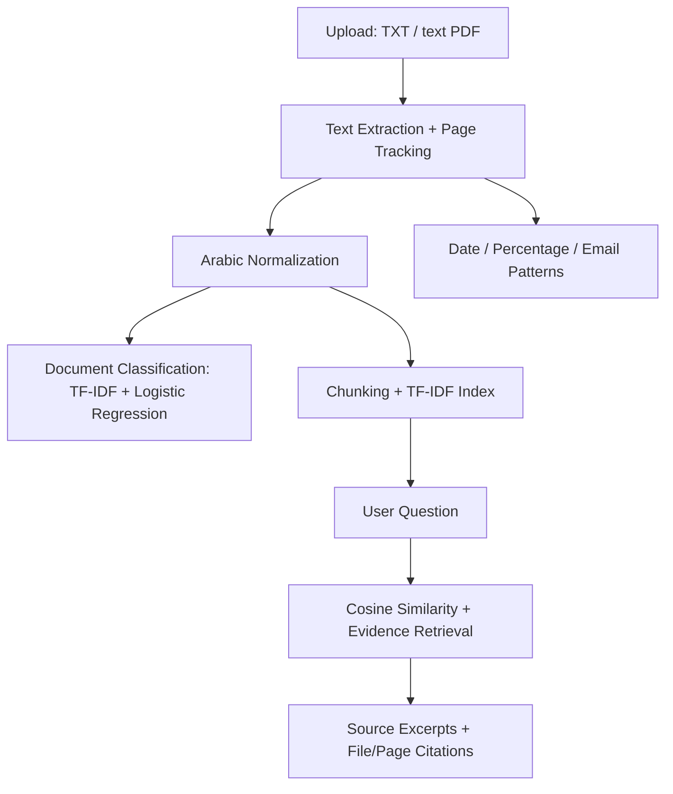

# Arabic Document Intelligence | ذكاء المستندات العربية

> **Arabic NLP Capstone** — A transparent, offline-first baseline for Arabic document extraction, classification, and evidence-grounded retrieval.
>
> **مشروع NLP تطبيقي** يعالج المستندات العربية ويصنفها ويعرض أدلة نصية من المستندات عند طرح الأسئلة.

   

## المشكلة والحل | Problem & Solution

تحتوي المستندات العربية على معلومات يصعب الوصول إليها يدويًا عند تزايد حجمها. يقدم المشروع **نموذجًا أوليًا قابلًا للتجربة** لرفع المستند، استخراج النص، اقتراح تصنيف، واسترجاع مقاطع تدعم الإجابة مع اسم الملف ورقم الصفحة حيث يتوفر.

**Important:** Q&A is *extractive retrieval*, **not** generative AI. The app quotes relevant text excerpts; it does not synthesize free-form answers or verify their factual correctness.

## الخصائص | Features

- 📄 **Extract:** ملفات PDF النصية وملفات TXT بترميز UTF-8.
- 🏷️ **Classify:** أربع فئات: `سياسات`، `تقارير`، `محاضر`، `إجراءات`.
- 🔎 **Retrieve:** البحث بمطابقة TF-IDF العربية وعرض المقاطع الأكثر ارتباطًا بالسؤال.
- 📍 **Cite:** إظهار اسم المصدر ورقم الصفحة لملفات PDF النصية.
- 📊 **Extract indicators:** التواريخ الرقمية والنسب المئوية والبريد الإلكتروني باستخدام Regular Expressions.
- 📥 **Export:** تنزيل ملخص التصنيف بصيغة JSON.
- ✅ **Evaluate:** بيانات تدريب واختبار مستقلة، ومقاييس Accuracy وMacro-F1 وHit@1 وHit@3.
- 🔐 **Local by design:** لا توجد استدعاءات API خارجية في الكود، ولا تُحفظ الملفات المرفوعة على القرص عبر التطبيق.

## بنية العمل | Pipeline



## تشغيل المشروع | Quick Start

**Prerequisite:** Python 3.11 or 3.12 recommended.

```bash
git clone https://github.com/YOUR_USERNAME/arabic-document-intelligence.git
cd arabic-document-intelligence
python -m venv .venv
```

تفعيل البيئة الافتراضية:

```bash
# macOS / Linux
source .venv/bin/activate

# Windows PowerShell
.venv\Scripts\Activate.ps1
```

تثبيت المتطلبات وتشغيل الواجهة:

```bash
python -m pip install -r requirements.txt
streamlit run app.py
```

ثم ارفعي أحد الملفات التجريبية من مجلد [`data/samples`](data/samples).

**التجربة من الطرفية:**

```bash
python -m scripts.demo
```

## اختبارات وقياس الأداء | Tests & Evaluation

```bash
python -m pytest -q
python -m scripts.evaluate
```

يكتب الأمر الأخير تقريرًا في [`reports/evaluation.json`](reports/evaluation.json). يتم تدريب نموذج التصنيف على `data/training/labels.csv` ويُقيّم على أمثلة منفصلة في `data/test/labels.csv`. تُستخدم حالات سؤال/دليل موجودة في `data/test/qa_questions.json` لتقييم الاسترجاع من مستندات `data/samples`.

### نتائج الإصدار التجريبي | Baseline Snapshot

| Metric | Result | Evaluation set |
|---|---:|---|
| Classification accuracy | 100% | 20 synthetic held-out texts |
| Classification macro-F1 | 1.00 | 20 synthetic held-out texts |
| Retrieval Hit@1 | 100% | 8 synthetic questions |
| Retrieval Hit@3 | 100% | 8 synthetic questions |
| Automated unit tests | 10 passed | PDF, TXT, retrieval, ML and evaluation |

⚠️ **هذه النتائج على بيانات تجريبية صغيرة سهلة عمدًا.** ليست تقييمًا على بيانات إنتاجية أو تقديرًا للقدرة على التعميم. ننصح بالاختبار على عينة واقعية مرخّصة، وبعد فصل البيانات إلى تدريب/اختبار دون تسرب، وقياس الدقة حسب الفئات ونوع المستند. انظري [`EVALUATION.md`](EVALUATION.md).

## هيكل الملفات | Repository Structure

```text
arabic-document-intelligence/
├── app.py                         # Streamlit UI
├── docintel/
│   ├── arabic.py                  # Arabic text normalization
│   ├── documents.py               # PDF/TXT extraction + chunks
│   ├── classification.py          # Supervised document classifier
│   ├── retrieval.py               # Evidence-grounded text retrieval
│   └── indicators.py              # Regex-based indicator extraction
├── data/
│   ├── training/labels.csv        # Synthetic training data
│   ├── test/labels.csv            # Held-out classification examples
│   ├── test/qa_questions.json     # Expected retrieval evidence
│   └── samples/*.txt              # Four synthetic example documents
├── scripts/demo.py                # Terminal example
├── scripts/evaluate.py            # Reproducible evaluation
├── tests/test_project.py          # Automated tests
├── reports/evaluation.json        # Evaluation result snapshot
├── .github/workflows/tests.yml    # GitHub Actions CI
├── .streamlit/config.toml
├── EVALUATION.md
├── WALKTHROUGH_AR.md
├── requirements.txt
└── LICENSE
```

## حدود النموذج | Limitations

1. لا يدعم **OCR**؛ الملفات المصوّرة لا تحتوي عادةً على نص قابل للاستخراج مباشرة.
2. يعتمد الاسترجاع على **التشابه المعجمي**، وقد يفوّت المرادفات أو يعيد دليلًا غير كافٍ. حد التشابه قاعدة بسيطة **وليس إثباتًا لصحة الإجابة**.
3. يعتمد التصنيف على مجموعة تدريب صغيرة مصطنعة، ولذلك لا يناسب قرارًا رسميًا أو حساسًا دون تدريب وتقييم شاملين. درجات الاحتمال **غير معايرة**.
4. استخراج التواريخ والنسب والبريد يتم بقواعد Regex، ولا يعني فهمًا عامًا لجميع أنواع الكيانات العربية.
5. ترتيب النص المستخرج من PDF يعتمد على الملف؛ بعض ملفات PDF قد تظهر فيها أحرف غير سليمة.
6. أقصى الحدود في النسخة التجريبية: 8 ملفات، 5 ميغابايت لكل ملف، 30 صفحة لكل PDF و100 ألف حرف مستخرج لكل مستند.

## السلامة والخصوصية | Privacy

جميع الملفات المرفقة بمجلد `data/samples` وهمية. **لا ترفعي وثائق داخلية أو سرية أو ذات بيانات شخصية إلى تطبيق منشور للعامة.** يقوم كود المشروع بمعالجة الرفع في الذاكرة دون كتابة الملفات على القرص أو إرسالها إلى واجهة AI خارجية؛ ومع ذلك فإن تشغيله على استضافة خارجية يخضع لشروط وبيئة الاستضافة ولا يعادل ضمانًا شاملًا للخصوصية. لا ترفعي ملفات حقيقية إلى GitHub.

## النشر على GitHub وStreamlit

1. افتحي GitHub وأنشئي مستودعًا عامًا أو خاصًا باسم `arabic-document-intelligence` **دون** إنشاء README أو License جديدين (هما موجودان).
2. نفّذي من داخل مجلد المشروع:

```bash
git init
git add .
git commit -m "Build Arabic Document Intelligence NLP capstone"
git branch -M main
git remote add origin https://github.com/YOUR_USERNAME/arabic-document-intelligence.git
git push -u origin main
```

3. يمكن نشر واجهة تجربة عامة باستخدام [Streamlit Community Cloud](https://share.streamlit.io/) باختيار المستودع و`app.py` بوصفه نقطة التشغيل. جربي دائمًا مستندات وهمية فقط. تحققي من صلاحيات الاستضافة والموارد قبل إتاحته.

## تطوير لاحق | Roadmap

- OCR عربي لملفات PDF المصوّرة.
- Arabic sentence embeddings for semantic retrieval.
- Stronger document taxonomy and human-in-the-loop labeling.
- More diverse, independently reviewed real-world benchmark data.
- Calibrated uncertainty + robust unanswerable-question evaluation.
- Secure deployment, authentication and access controls for enterprise use.

## Attribution

Independent educational prototype inspired by an Arabic NLP training capstone brief; it is **not an official SDAIA product or endorsed software**. MIT licensed. No organizational logos or proprietary materials are included.
